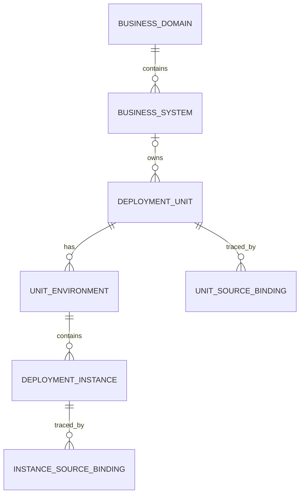

# 02：部署单元与部署实例设计

日期：2026-10-21。状态：设计建议，尚未建表或实施。

依据：[DevOps 应用与环境数据分析](01-devops-applications-and-environments.md)。现有采集流程、JSON 文件和 snapshot 定义保持不变；本设计增加的是读取已有快照、建立平台管理对象的后续能力。

后续补充：[部署实例每日更新与进程身份识别](03-instance-refresh-and-process-identity.md) 细化本文件的更新、进程匹配与来源观察头，并提出运行历史所需的附加表；相关细节以该补充建议为准。

## 1. 已确认需求与本次建议

用户已明确：

- 一个 DevOps 应用对应一个部署单元；部署单元是逻辑对象。
- 部署单元还要容纳数据库、Redis、Kafka、MQ、ZooKeeper、Nacos 等没有 DevOps 应用 ID 的对象。
- 未来分类层次是“业务领域 → 业务系统 → 部署单元 → 部署实例”。
- 实例区分 TEST、SIMULATION、PRODUCT，每个环境可以没有部署，也可以部署到多个目标。
- 需要新建领域、系统、部署单元、部署实例的数据表；当前先用应用快照建立单元和实例。

本次提出的关键建议：

1. 部署单元、部署实例使用平台独立 ID，外部应用 ID、部署 ID、配置 ID、PID 不作为平台主键。
2. 应用 ID 是可选的来源关联。没有应用 ID 的单元合法，不创建虚拟应用、不填 0 或伪造 ID。
3. 实例按“某环境中的一份部署成员”表达；服务器是部署位置，同一服务器可以承载多个实例。
4. 领域和系统先建基础结构，当前不创建虚构分类，不按名称或代码组自动推断。
5. 业务管理信息、来源观测、匹配结果分别保留；快照更新不能覆盖人工分类或直接删除管理对象。

这些是设计建议，不表示部署 ID 的生命周期、数据库集群边界等业务含义已经得到来源契约确认。

## 2. 两个核心对象的定义

### 2.1 部署单元 Deployment Unit

表示可以独立识别、管理其部署的逻辑应用或服务组件，跨环境保持同一逻辑身份。

示例：订单服务、订单缓存、消息集群、配置注册服务。不能仅按软件类型建立一个全公司的“Redis 单元”或“Kafka 单元”；不同用途、不同独立管理边界的同类服务应分别管理。

当前规则：同一 DevOps 来源实例中的一个 app ID 绑定一个部署单元。一个仓库可能对应多个应用，因此不能改成“一个 Git 仓库一个部署单元”。

### 2.2 部署实例 Deployment Instance

表示某部署单元在指定环境中，一份可被定位和观察的部署成员。

- 应用：某环境中的一份应用部署，第一期通过快照中的部署条目和目标 IP 建立。
- 自建中间件：未来可表示一个节点/服务部署，其运行进程和端口作为证据。
- 托管数据库或中间件：未来可表示可独立识别的云资源实例，通过原生资源 ID、域名/Endpoint 定位，不强制要求可登录服务器或 PID。

实例与服务器不是一对一：同机可以有不同部署单元，也可以有同一部署单元的多个部署；实例数和去重服务器数应分别统计。进程重启也不必然意味着新建部署实例。

对于只暴露整体资源的托管集群，先以 MANAGED_RESOURCE 粒度表示，不把未知内部节点虚构为实例。未来展开节点时要另定节点明细与统计粒度，不能把“整体集群 + 全部节点”平铺后混算实例总数。

## 3. 层次与环境关系



`UNIT_ENVIRONMENT` 是部署单元与环境的关联，不增加新的业务分类层级。

```text
业务领域（未来维护）
  └─ 业务系统（未来维护）
       └─ 部署单元：订单服务 DU-001
            ├─ TEST：0 个实例
            ├─ SIMULATION：1 个实例
            └─ PRODUCT：2 个实例
```

没有规划系统时，部署单元的 `system_id = NULL`，仍然可以创建与查询。领域由所属系统关联得到，避免在单元上另存一个可能与系统冲突的 `domain_id`。

未来已知领域但还没有系统时，可以先通过待分类事项记录，不创建“未知系统”占位。本期采用“确定系统后沿系统得到领域”的一致规则；是否支持单元单独预归领域，可在分类功能阶段另行讨论。

一套单元的三个环境可以都没有实例。初始化环境关联记录不表示已经存在环境配置，配置状态必须来自来源观察。

## 4. 应用 ID 可选：采用来源关联表

### 4.1 请求中的四个字段如何表达

| 需要的信息 | 建议表达 |
|---|---|
| 部署单元 ID | `deployment_unit.id`，平台生成，长期稳定 |
| 部署单元名称 | `deployment_unit.name`，初始化使用应用名，允许平台维护 |
| 应用 ID | 通过 `deployment_unit_source` 的 DevOps 绑定获得；列表/API 返回可空 `appId` |
| 部署单元类型 | `deployment_unit.unit_type`；技术产品另用 `technology_code` |

推荐不把 app ID 作为主表必填列，来源表承载映射。这样后续同一逻辑单元可以关联其他来源证据，而不用不断增加 `app_id/redis_id/kafka_id/...`。

```json
{
  "id": "DU-001",
  "name": "订单服务",
  "unitType": "APPLICATION",
  "technologyCode": null,
  "appId": "APP-101",
  "systemId": null,
  "businessDomainId": null
}
```

```json
{
  "id": "DU-002",
  "name": "订单缓存",
  "unitType": "MIDDLEWARE",
  "technologyCode": "REDIS",
  "appId": null,
  "systemId": null,
  "businessDomainId": null
}
```

以上 ID 和名称均为示意，不来自生产清单。`appId`、`businessDomainId` 是查询视图字段，分别通过来源绑定、所属系统读取。

### 4.2 单元类别与技术产品分开

| `unit_type` | `technology_code` 示例 | 当前创建方式 |
|---|---|---|
| APPLICATION | 暂可为空；以后按确认规则填写 | DevOps 应用初始化 |
| DATABASE | MYSQL、POSTGRESQL、MONGODB 等 | 后续从发现候选/原生资源确认建立 |
| MIDDLEWARE | REDIS、KAFKA、RABBITMQ、ROCKETMQ、ZOOKEEPER、NACOS 等 | 后续从发现候选/人工确认建立 |
| OTHER | 已确认但不属于以上分类的技术标识，可为空 | 人工明确分类 |

MQ 仅是宽泛称呼，不能无证据填写成 RabbitMQ 或 RocketMQ。来源中的 DevOps `appType` 和页面“仓库分类”也不等于部署单元类别；先作为来源属性保留，不未经映射规则直接写成技术产品。

同样，JumpServer 资产 ID 表示机器，不表示该机器上的某一个中间件服务。PID、端口服务类型提示都不能单独充当部署单元的稳定身份。

## 5. 四张业务主表

下面是逻辑字段设计，不是已执行的建表脚本。平台内部 ID 类型统一，外部 ID 用字符串保留。时间按 UTC 保存，界面按北京时间展示。所有主表使用平台行修订号进行并发更新控制。

### 5.1 `business_domain`：业务领域

| 字段 | 必填 | 说明 |
|---|---|---|
| `id` | 是 | 平台主键 |
| `code` | 是 | 平台领域编码，唯一 |
| `name` | 是 | 领域名称，名称不充当身份 |
| `description` | 否 | 说明 |
| `management_status` | 是 | ACTIVE / DISABLED / ARCHIVED |
| `revision` | 是 | 人工维护修订号 |
| `created_at / updated_at` | 是 | 平台创建/修改时间 |

当前先建空表，不根据应用名、仓库组或机房创建领域。存在系统引用时不允许物理删除；停用与数据删除分别处理。

### 5.2 `business_system`：业务系统

| 字段 | 必填 | 说明 |
|---|---|---|
| `id` | 是 | 平台主键 |
| `domain_id` | 是 | 所属领域外键；本期不创建系统，未来有明确领域后建立 |
| `code` | 是 | 平台系统编码，唯一 |
| `name` | 是 | 系统名称 |
| `description` | 否 | 说明 |
| `management_status` | 是 | ACTIVE / DISABLED / ARCHIVED |
| `revision` | 是 | 平台维护修订号 |
| `created_at / updated_at` | 是 | 平台时间 |

一个系统归属一个领域；系统下可以有多个部署单元。未来移动系统的领域归属时记录变更历史。存在部署单元引用时不级联删除。

### 5.3 `deployment_unit`：部署单元

| 字段 | 必填 | 说明 |
|---|---|---|
| `id` | 是 | 平台主键，独立于 app ID |
| `code` | 是 | 平台生成的唯一单元编码，名称改变时不变 |
| `name` | 是 | 管理名称，初始使用应用名 |
| `unit_type` | 是 | APPLICATION / DATABASE / MIDDLEWARE / OTHER |
| `technology_code` | 否 | 已确认的技术产品；未知时为空 |
| `system_id` | 否 | 所属业务系统；当前为空 |
| `description` | 否 | 人工说明 |
| `creation_origin` | 是 | DEVOPS_IMPORT / DISCOVERY_CONFIRMATION / MANUAL |
| `name_policy` | 是 | FOLLOW_SOURCE / MANUAL；人工改名后不被同步覆盖 |
| `management_status` | 是 | ACTIVE / DISABLED / ARCHIVED，表示管理状态 |
| `revision` | 是 | 记录修改修订号 |
| `created_at / updated_at` | 是 | 平台时间 |

主表不保存 PID、IP、具体环境、配置 ID、发布状态等。应用 ID 通过来源关联读取，默认仓库与原始 appType 等通过来源观察读取。

一个单元本期最多有一个主要 DevOps 应用绑定；没有绑定合法，但以 DEVOPS_IMPORT 创建的单元必须在同一创建事务中建立绑定。人工管理的 system/type/description/status 由平台维护，不随快照覆盖。

共享中间件先保持一个单元，所属系统代表主要管理归属，可以暂空。其他系统通过“依赖该单元”表达使用关系，不能为每个使用方复制一个中间件单元；依赖关系后续另建。

### 5.4 `deployment_instance`：部署实例

| 字段 | 必填 | 说明 |
|---|---|---|
| `id` | 是 | 平台主键，不能由 IP、PID 或当前字段哈希直接充当 |
| `unit_environment_id` | 是 | 指向单元—环境关联；由此唯一获得 unit 和 environment |
| `name` | 否 | 管理名称；缺失时界面按位置生成显示文案 |
| `instance_kind` | 是 | 首期 HOST_DEPLOYMENT；未来 MANAGED_RESOURCE / SERVICE_NODE 等 |
| `primary_ip` | 否 | 当前主要定位 IP；托管资源可能只有域名 |
| `service_address` | 否 | 未来托管资源域名/访问地址，不用于强制生成服务器 |
| `network_scope_key` | 否 | 已知的云账号/VPC/机房等网络范围；未知保持空，不假定全局唯一 |
| `declared_port_raw` | 否 | 来源声明端口，保留原值；不冒充实际监听 |
| `transport_protocol` | 否 | 有直接证据才填写；未知不补 TCP |
| `host_reference_json` | 否 | 已确认或候选机器来源引用及 confidence/evidence；不只保留 IP |
| `identity_quality` | 是 | 来源/跨次观察匹配的 EXACT / INFERRED / AMBIGUOUS / UNKNOWN；不代替主机归属或进程归属的独立置信度 |
| `management_status` | 是 | ACTIVE / DISABLED / ARCHIVED |
| `presence_status` | 是 | PRESENT / NOT_OBSERVED / UNKNOWN，表示来源观察状态 |
| `current_observation_id` | 否 | 当前采用的来源观察，须指向本实例的已发布导入记录 |
| `first_seen_at / last_seen_at` | 否 | 来源观察时间，不是平台插入时间或推定的创建/删除时间 |
| `revision` | 是 | 平台修改修订号 |
| `created_at / updated_at` | 是 | 平台时间 |

IP/声明端口等是为当前查询准备的投影，更新必须伴随追加来源观察；原始部署 ID、配置 ID、仓库/分支、PushIn 状态和监听/进程证据保存在观察中，不能只留下覆盖后的当前值。

一期不对 `(IP)` 或 `(单元, 环境, IP)` 建实例唯一约束。常用索引为 `unit_environment_id`、`presence_status`、`primary_ip`；IP 索引用于搜索，不用于证明身份。

## 6. 为保证语义而需要的辅助表

建议本期共建 10 张表：上述四张业务表，加以下六张。领域/系统表先为空，其余支撑单元/实例的初始化与后续更新。

### 6.1 `deployment_unit_environment`

字段：`id, unit_id, environment, configuration_state, coverage_state, current_observation_id, observed_at, updated_at`。

- 唯一键：`(unit_id, environment)`；environment 仅 TEST / SIMULATION / PRODUCT。
- `configuration_state`：UNCONFIGURED / CONFIGURED_EMPTY / HAS_DEPLOYMENTS / UNKNOWN。
- `coverage_state`：COMPLETE / PARTIAL / UNKNOWN，表示本次观察是否足以描述该环境。
- 无环境配置、配置存在但无部署、存在部署条目、未确认四种状态分别保存。
- HAS_DEPLOYMENTS 表示来源返回部署条目，不保证每条都有 IP 或已能创建实例。
- 当前实例个数按 PRESENT 实例统计；服务器数量按有证据的定位信息去重。未解析条目数量单独展示。

因此，“0 个已确认实例”仍可有不同配置状态或未解析条目，不能统一显示成“没有部署”。

### 6.2 `deployment_unit_source`

字段：`id, unit_id, source_instance_key, object_kind, native_key_json, native_key_hash, binding_role, presence_status, first_seen_at, last_seen_at, latest_observation_id, confidence, evidence_json`。

- 主要来源对象：DEVOPS_APPLICATION；未来可扩展已确认的原生服务/资源标识。
- DevOps 键为 `{sourceInstance, appId}`；来源实例不同的相同 app ID 不自动归并。
- 唯一键：`(source_instance_key, object_kind, native_key_hash)`，保证同一个来源对象不会绑定多个单元。
- 对 DEVOPS_APPLICATION 另限制每个 unit 最多一个此类主要绑定；其他资源来源可多条。
- Git 仓库可能被多个单元使用，应另作多对多属性/关系，不能放进这个排他绑定规则。

来源绑定不要求外部应用已导入另一张数据库应用表，原始证据仍在 JSON；因此不需要为了数据库/中间件创建空应用行。

### 6.3 `deployment_instance_source`

字段：`id, instance_id, unit_environment_id, source_instance_key, object_kind, native_key_json, native_key_hash, identity_strength, confidence, matching_basis, first_seen_at, last_seen_at, evidence_json`。

保存平台实例与来源部署成员的对应；`identity_strength=STRONG/WEAK` 与匹配 confidence 分别表达键的可靠性和本次判断。唯一键为 `(source_instance_key, object_kind, native_key_hash, unit_environment_id)`。

unit_environment_id 必须与 instance 所属环境一致，不能通过来源绑定把记录跨环境接到同一个实例。托管资源在不同环境被共享时可分别存在部署上下文并引用同一物理资源；物理资源关联不等于新增两台机器。共享事实不应被抹掉，也不引入未经约定的“SHARED 环境”。

### 6.4 `catalog_import_run`

字段：`id, source_instance_key, source_version, source_relative_path, snapshot_sha256, mapper_version, scope_json, completeness_json, observed_at, imported_at, status, previous_current_run_id NULL, applied_change_batch_id NULL, counts_json, error_summary`。

- 一个导入是对已有快照的读取，不重新采集。
- 幂等键建议为 `(source_instance_key, source_version, snapshot_sha256, mapper_version)`。
- WRITING / VALIDATING / READY / FAILED；READY 才能成为当前管理视图采用的观察。
- 文件引用基于配置数据卷，不引入宿主机绝对路径；历史原文/文件哈希可回溯。
- 所需导入/更新可以在一个事务中提交；数据量较大时先写隐藏暂存结果，再通过短事务发布，不能将半份导入暴露成当前状态。
- 同来源导入串行执行，发布前检查该来源采用的前一批次仍是预期批次；实现时可对正在运行批次建立唯一占位约束。人工维护则由各对象 revision 检查保护，无需在本期额外引入一张全局目录版本表。

### 6.5 `catalog_observation`

字段：`id, import_run_id, record_kind, unit_id NULL, unit_environment_id NULL, instance_id NULL, source_locator_json, source_locator_hash, observed_at, time_basis, source_presence, confidence, matching_basis, source_attributes_json, evidence_json, semantic_hash`。

`record_kind` 与唯一非空的对象引用配对：APPLICATION 对 unit；ENVIRONMENT 对 unit_environment；DEPLOYMENT 对 instance；UNRESOLVED_DEPLOYMENT 对 unit_environment。三个对象引用都是实际外键，检查约束保证不同时指向多个对象。

来源属性按观察类型保存：

- APPLICATION：原应用 ID、名称、类型、HTTP 名、默认仓库/分支/端口等。
- ENVIRONMENT：原配置/部署列表状态、完整性、未解析数量。
- DEPLOYMENT：原 deploy/config、IP、声明端口、仓库/分支与依据、lastPublishedAt/publishStatus/pushIn、读取状态及错误。
- UNRESOLVED_DEPLOYMENT：尚未定位目标或有冲突的原始条目、原因及候选。

后续进程/监听/连接证据带独立检查时间和输入文件引用，不能冒充 DevOps 来源字段。原始 source_attributes/evidence 采用 JSON 保存，常用筛选字段在实施时按确认需求拆列。

唯一键为 `(import_run_id, record_kind, source_locator_hash)`；不将可能很长的 JSON Pointer 直接当索引键。重复导入同一批不重复插观察；新一轮采集即使属性相同，仍允许保存新的观察时间。

### 6.6 `catalog_change`

字段：`id, change_batch_id, object_type, object_id, action, before_json, after_json, actor_type, actor_id, import_run_id NULL, changed_at, reason`。

只追加，记录创建、名称跟随、人工改名、分类、状态及来源投影变化。actor 区分 USER / IMPORT。每个原子更新批次分配一个唯一 change_batch_id，用于将同次操作归组；它不是用于比较新旧的全局递增版本号。导入发布检查来源基线及待更新对象的行修订，防止覆盖并发人工编辑。

来源观察历史和管理操作历史是两回事：旧快照记录当时看到了什么；catalog_change 记录平台管理对象何时被怎样修改。来源文件的旧版本切换不自动回退人工维护的系统归属或单元名称。

## 7. 从现有应用列表初始化

### 7.1 单元创建

1. 固定一份成功的应用快照及哈希、source instance、scope；核对 complete、ID 重复和格式。
2. 对每个 app，以来源实例 + app ID 查找已有绑定。
3. 没有绑定时创建一个 APPLICATION 单元，名称使用 app.name，system/technology 暂空，并建立绑定；名称初始 FOLLOW_SOURCE。
4. 已有绑定则沿用 unit ID，追加观察；仅按字段管理策略更新来源跟随属性。
5. 对每个单元准备三个环境关联，状态按现有记录确定，未知仍为 UNKNOWN。

如果快照有 361 个唯一应用，而平台尚未导入过，则拟创建 361 个单元；不是创建 1083 个单元。已有同源绑定的应用不重复创建。人工已存在但未绑定的同名单元不自动合并，应保留为待关联项。

### 7.2 实例创建

1. 读取 app.envs[TEST/SIMULATION/PRODUCT]，先排除完全相同的重复条目。
2. 无环境配置、无部署实例等占位记录只更新环境状态，不生成虚假实例。
3. 有目标 IP 的部署条目进入实例识别流程；没有 deploy ID 时仍可作为弱身份观察处理。
4. 有 deploy/config 但缺 IP 的条目保存为 UNRESOLVED_DEPLOYMENT，暂不创建已定位 HOST_DEPLOYMENT 实例。
5. 对能区分的部署成员建立/匹配实例，记录定位信息、来源依据和 identity_quality。
6. 同 IP 不同 deploy/端口等记录不能直接折叠；不能区分是重复还是不同部署时保存冲突与候选，不任意选一条。

示意：APP-101 在 TEST 无部署、SIMULATION 有一个目标、PRODUCT 有两个目标，将建立 1 个部署单元、3 个环境关联、3 个实例。另一应用即使使用同一生产 IP，也有自己的部署单元与实例，服务器去重统计可以为共享机器。

### 7.3 实例身份与跨次匹配

平台 instance ID 一经创建，不随 IP、分支、发布时间、PID 变化而重新计算。但“应沿用哪个 ID”要以来源证据为依据：

| 证据 | 建议处理 |
|---|---|
| 已确认稳定且唯一的来源部署成员 ID | 在同单元/环境内沿用绑定；位置变化记录为实例属性变化 |
| 同一 deploy ID 对应多目标 | 必须额外区分部署成员；有稳定机器/目标 ID 才能建立强键 |
| 只有 deploy/IP/声明端口等组合 | 可作为弱来源键，唯一重复匹配时保留 INFERRED 连续性，不证明同一进程或物理机器 |
| 没有 deploy ID，只有 IP/声明端口 | 仅在同单元、同环境、相同可确认范围内作为弱匹配候选，禁止跨应用/环境复用 |
| IP 或 deploy ID 改变且无稳定依据 | 记录新旧候选或创建新观察实例，不凭名称断言为原实例迁移 |
| 出现多个候选或冲突 | 不更新任意已有实例，留在未解析观察/待关联中 |

来源部署 ID 的唯一性和生命周期尚未确认，所以本期不能默认将 appId+env+deployId 设为无条件可靠的长期业务主键。弱匹配键须排除分支、配置 ID、发布时间、发布状态等可变观察属性；否则每次发布都会错误创建实例。

首次导入允许为明确可区分的目标创建平台管理对象，同时标注来源身份较弱；不将创建了平台 ID 宣称为已确认物理身份。

## 8. 后续同步与生命周期

| 场景 | 部署单元/实例处理 |
|---|---|
| 新应用出现 | 新建单元及相应环境/实例，已有绑定不重复创建 |
| 同 ID 应用改名 | FOLLOW_SOURCE 时跟随并记历史；MANUAL 时仅更新来源名称观察 |
| 分支、配置、发布时间变化 | 更新实例来源观察/投影，不因这些属性单独新建实例 |
| 同一稳定来源成员更换 IP | 有足够身份依据才沿用实例 ID 并更新位置，否则保留待确认关系 |
| 应用不再出现在可比较的完整清单 | 来源绑定标记 NOT_OBSERVED，不自动删除单元或清空人工分类 |
| 部署成员不再出现 | 仅在该环境完整可比时标记未观察到；保留历史，不伪造退出/删除时间 |
| 来源失败、scope 改变或环境未完整采集 | 不批量把旧对象判为消失；状态 UNKNOWN/保留原观察并提示覆盖缺口 |
| 已禁用/归档单元再次被观察 | 保留管理状态并提示来源仍存在，不静默自动启用 |
| 人工调整系统归属或说明 | 同步不得覆盖；追加管理变更历史 |
| 查看旧快照 | 展示该输入的来源观察，不自动将当前管理目录改写为旧版 |

应用由 361 减为 351 时，不要求平台单元总数也立刻变成 351：当前来源可见数、平台管理对象数、已归档数是不同指标。用户确认清理原因后，可以显式停用/归档对应单元；实例管理状态与实际运行状态也分开。

导入只消费选定快照。单独同步其他来源时，复制过来的旧 DevOps 快照不应被当成一次新的 DevOps 观察。遇到较旧观察或历史重导入，只导入历史，不覆盖较新来源状态；观察时间/来源先后不明的候选不自动激活。

## 9. 没有应用 ID 的数据库/中间件如何建立

后续建议采用“发现候选 → 身份核对/分组 → 绑定已有单元或新建单元 → 建立环境实例”的路径。发现过程不要求先有 app ID。

示例：两个应用都连接到同一个 Redis Endpoint，应首先得到一个待识别服务候选；核对后可以绑定到“订单缓存”单元，而不是因两个调用方各创建一个 Redis 单元。

| 可获得证据 | 可以支持 | 仍不能直接推导 |
|---|---|---|
| IP + Port + Protocol 连接 | 某观察窗口内的对端 Endpoint | 单元名称、系统归属、集群边界或业务领域 |
| 对端真实 PID/进程/容器 | 更具体的运行服务类型与归属候选 | 该服务跨环境应如何归组、PID 是否长期不变 |
| 仅监听进程/端口类型推断 | 服务候选及 INFERRED 证据 | 已精确确认连接所有者或业务应用 |
| 云原生资源/集群 ID | 该来源中的独立资源身份 | 不同环境资源是不是同一个逻辑单元 |
| 只有相同进程名或常用端口 | 弱服务类型提示 | 唯一实例、唯一单元或完整集群 |

EXACT 的连接所有者确认也不能自动使“系统归属/集群分组”变为 EXACT，各层判断独立保留依据。环境未知时留在候选，不能默认归生产；不同 VPC 的同 IP 不自动合并。

数据库粒度建议先以可独立部署/运维的数据库服务或集群作为部署单元，不因一个 MySQL 上有多个 schema 就自动生成多个单元。Redis 采用独立服务/集群、Kafka 采用集群；具体独立管理边界需业务确认。跨 TEST/SIMULATION/PRODUCT 的同用途组件是否归一个单元，同样需要确认，不仅按相似名称推断。

这部分本期只预留来源和类别能力。后续可新建 `deployment_discovery_candidate` 与 `deployment_unit_dependency` 保存候选和带环境/时间/证据的依赖；不在本期仅靠进程名自动创建中间件管理对象。

## 10. 约束与数据库实现注意点

不论最终使用哪种数据库，下列约束都需要成立：

1. 同源同 app ID 不绑定多个部署单元；同一单元本期最多一个主要 DevOps 应用。
2. 单元—环境唯一；实例始终属于其中一个部署上下文，引用不得串单元/环境。
3. 单元名称、IP、端口、PID 不作为全局唯一身份键。
4. 已有引用的领域、系统、单元不级联物理删除；以管理状态与可追溯操作处理。
5. 观察必须关联导入批次、源版本/哈希、原始记录位置；current_observation 只能引用本对象的 READY 批次观察。
6. 新建单元与主来源绑定原子完成；重复导入和并发创建由唯一键、事务及修订检查共同保护。
7. 观察表与变更表追加写；来源状态、人工管理状态和运行状态不可共用一个 status 字段。

如果落地 MySQL，可用来源复合唯一键防重复，用外键维护层次，用 CHECK 保证观察对象引用组合和环境取值。每 unit 最多一个 DevOps 绑定，可用生成列：仅 DEVOPS_APPLICATION 记录投影 unit_id，其余为 NULL，再对此列建立唯一索引；MySQL UNIQUE 允许多条 NULL。[唯一索引说明](https://dev.mysql.com/doc/refman/8.4/en/create-index.html)、[生成列索引](https://dev.mysql.com/doc/refman/8.4/en/create-table-secondary-indexes.html)、[CHECK 说明](https://dev.mysql.com/doc/refman/8.4/en/create-table-check-constraints.html)

跨表状态门禁、current_observation 所属对象核验、人工归档规则仍需服务事务保证，不能假定普通外键已表达这些业务约束。MySQL 物理字段类型、完整 DDL 与迁移版本应在本轮概念确认后另行产出。

## 11. 建议的首期范围与验证

首期实现范围：10 张表；读取一份成功应用快照；初始化单元、环境与实例；来源绑定和导入幂等；来源/人工信息分离；观察历史与变更历史。所有导入和持久化能力在容器边界内实现，原始证据继续使用现有数据卷。

初期不创建真实领域/系统数据，不自动划分中间件集群，不改采集输出，不将部署目录时间/进程启动时间写成 PushIn 发布时间。

后续实施至少验证以下小型脱敏场景：

- 一个应用、三个环境、0/1/2 个部署目标，生成 1 单元、3 环境、3 实例。
- 同一份快照重复导入，不重复建对象或来源绑定；同名不同 app ID 不合并。
- 不同单元同 IP、同单元同 IP 多部署成员，实例与服务器计数分开。
- 无环境配置、无部署、缺 IP、没有部署 ID、多候选冲突分别处理。
- 更新发布时间/分支/PID 不单独导致实例重建；弱身份变化不会被强行认定为迁移。
- 人工改名/归属与同步并发时，修订检查保护人工数据。
- 应用/实例缺失、scope 改变、失败快照、重导入旧快照不引发错误删除或回滚。
- 没有 app ID 的手工数据库/中间件单元合法，且后续可绑定来源而不创建虚拟应用。
- 托管域名资源不要求 PID/服务器；未知环境、同 IP 跨网络保留待确认。

## 12. 本轮结论与仍需讨论的边界

建议确定：部署单元使用独立平台身份；app ID 为可选来源关联；应用与单元一对一；单元跨环境，实例属于具体环境；领域/系统先建空结构；先用快照建立管理目录，采集不改。

以下建议需在后续业务讨论中确认，不阻止先审阅表结构：

1. 实例是否接受“同机多份部署”的粒度，而不强制等同服务器。
2. 来源 deploy ID 在换机、重发、扩缩容时的实际生命周期，决定跨次匹配可用的强键。
3. 单元默认名称是否采用 FOLLOW_SOURCE，人工改名后转 MANUAL。
4. 数据库/中间件以独立服务或集群为单元的具体边界，以及跨环境分组方式。
5. 领域已知而系统未知时，是否需要独立的临时预分类能力；本期先保持 system_id 为空。

本次交付为设计文档与分析索引，尚未执行建表、导入数据或修改应用运行行为。

## 13. 现有实现依据

- [现有应用分析](01-devops-applications-and-environments.md)：清单、部署记录和来源差异。
- [daily_collection.py](../daily_collection.py)：`collect_application` 的仓库、分支、端口、步骤来源。
- [inventory.ts](../environment-web/lib/inventory.ts)：三环境、部署记录与整条记录去重。
- [application-check.ts](../environment-web/lib/application-check.ts)：应用 ID 可空，连接/监听/服务类型各自保留 confidence 与候选。
- [RESOURCE_SCHEMAS.md](../RESOURCE_SCHEMAS.md)：Endpoint、DMS 原生资源与地址、拓扑证据、未知/歧义语义。
