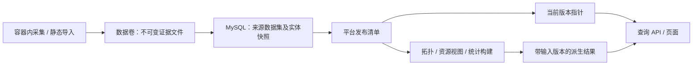

# Env-Scope 现有采集数据落库与版本管理设计

状态：设计草案，尚未实施。日期：2026-10-21。

本轮范围：已有 JSON 快照、进程检查、原始配置附件、拓扑及核验报告的存储、同步、查询和版本管理。领域、系统、模块、部署单元、部署实例的业务主数据另行设计。本文件不改变现有快照契约；当前行为仍以源码和 `RESOURCE_SCHEMAS.md` 为准。

## 1. 建议与边界

建议采用 **MySQL 作为平台主库，数据卷保留原始证据文件**。数据库使用关系表保存版本、常用查询字段和关联，JSON 列保存各来源扩展字段。第一期只部署一个数据库，不同时引入 MongoDB、消息队列、图数据库或数仓。

版本模型采用：**不可变的来源数据集 + 引用这些数据集的平台发布版本 + 独立的派生结果版本**。第一期每个新来源数据集保存完整记录，未同步的来源复用既有数据集。不采用需要逐层回放才能恢复历史的增量链，也不为每次采集新建数据库或新建一套表。

| 选择点 | MySQL | MongoDB | 本项目判断 |
|---|---|---|---|
| 现有嵌套快照 | 核心字段拆列，扩展放 JSON | 适合按实体保留嵌套文档 | 两者都能承载，文件格式不决定数据库 |
| 后续系统治理、研发报表 | 便于表达多对多、约束和跨域聚合 | 可以实现，需要管理引用与聚合管线 | 未来关系与统计需求更支持 MySQL |
| 版本发布 | InnoDB 事务更新指针及审计 | 可用事务；需要相应副本集部署 | 本方案以 MySQL 为落地基线 |
| 原始大文件 | 保留文件，数据库存索引与校验和 | 同样需要文件策略 | 不把整个采集批次塞进一行/一个文档 |

这是一项基于项目目标的选型判断，并非 MongoDB 无法实现。MySQL 支持 JSON，但常用过滤字段应拆成普通列；JSON 索引需要使用适当的生成列或表达式，不能假定整列自动可索引。[MySQL 官方说明](https://dev.mysql.com/doc/refman/8.4/en/create-table-secondary-indexes.html)

如果公司已有成熟 MongoDB 运维体系，可按第 12 节使用相同逻辑模型。MongoDB 单文档上限为 16 MiB；跨文档事务需使用副本集或分片集群，standalone 不支持此类事务。[文档限制](https://www.mongodb.com/docs/manual/reference/limits/)、[事务部署要求](https://www.mongodb.com/docs/manual/core/transactions-production-consideration/)

## 2. 当前实现中必须保留的事实

以下结论来自有针对性的源码检查，未读取生产全量快照。

| 当前行为 | 证据位置 | 对新方案的影响 |
|---|---|---|
| `/data/versions/<id>` 保留采集版本，`current.json` 指向激活版本；失败保留旧版 | `environment-web/runtime/service.py`：`start/work/activate` | 沿用候选、校验、原子发布、回退的思路 |
| 单独同步先复制其他来源，再替换目标来源 | 同上：`work` | 新版不必物理复制，发布清单引用原数据集 |
| 单台服务器重采只替换该资产 inspection/specs；其他资产沿用，根采集时间不能代表所有记录 | `environment-web/runtime/collect.py`：`jumpserver_asset` | 需要记录级观察时间、继承来源与检查覆盖范围 |
| `repositories.json` 混合 Codeup、Local GitLab、DevOps 引用及匹配结果 | `daily_collection.py`：`reconcile`；`runtime/collect.py` | 来源事实与跨来源关联分开；旧混合快照需要兼容导入 |
| Codeup 已计算去重 SHA 的每日提交数，但输出没有完整提交明细 | `daily_collection.py`：`collect_commit_history` | 当前可落每日统计；不能从输出还原作者、每个 SHA 等明细 |
| DevOps 保存所观察到的 PushIn/步骤信息及最近发布时间 | `daily_collection.py`：`collect_application/latest_push_in` | 可提取已观察动作，不能承诺完整发布历史 |
| DNS、EIP 从镜像内静态快照读取，不随采集版本冻结 | `runtime/service.py`：`TOPOLOGY_STATIC_FILES/generate_topology` | 新方案将静态导入也作为来源版本，否则历史回放不完整 |
| Nginx 原文按资产归档，可能通过 `configurationVersion` 指向旧目录 | `runtime/collect.py`；`RESOURCE_SCHEMAS.md` | 保存实际附件引用，不能只保留新目录里的快照 |
| topology 有独立目录与 `sourceVersion`；当前 latest 是全局指针 | `runtime/service.py`：`generate_topology/topology_status` | 新查询必须同时核对输入发布版本，避免展示旧输入的拓扑 |
| 应用核验任务及日志归档在 `/data/checks`，核验不会创建采集版本 | `runtime/service.py`；`RESOURCE_SCHEMAS.md` 第 11 节 | 独立任务/报告关联输入版本，不伪装成全量采集 |
| 页面模块直接 import JSON，版本激活会重新构建页面 | `lib/inventory.ts/repositories.ts`；`runtime/service.py`：`activate` | 仅导入数据库不会自动改变页面读取方式 |
| 镜像构建会从 collectors 上下文复制根目录的部分采集器 | `environment-web/Dockerfile` | 后续实现须检查镜像最终代码，不能只改 runtime 中的副本 |

`RESOURCE_SCHEMAS.md` 未完整列出代码里的 `commitDailyCounts`、`serverUsage`、`webapps` 等字段。导入器应按源文件版本适配，并保留未知扩展字段；不能按文档旧字段白名单丢弃数据。DMS 目前仅资源页面展示，落库不等于自动进入拓扑。

## 3. 总体数据流



三类数据分别承担不同职责：

1. **证据**：现有采集输出、静态导入文件、Nginx 配置原文、核验报告。保留精确字节及 SHA-256。
2. **可查询的来源事实**：仓库、应用、部署记录、ECS、CLB、DNAT、资产、进程等。使用同一套表，以 `dataset_id` 区分版本。
3. **派生结果**：资源宽表、跨来源主机归并、仓库与应用关联、拓扑、风险、报表。固定输入发布版本和算法版本，可重新生成。

原始证据不因归一化而消失；归一化结果不可反过来覆盖原始文件。人工维护的系统名称、负责人、归属等未来放在业务主数据中，采集同步只更新来源事实。

## 4. 版本语义

| 名称 | 示例 | 含义 |
|---|---|---|
| 采集任务 `sync_run` | J1 | 一次同步请求，可失败或重试，不等于可用数据版本 |
| 来源版本 `dataset_version` | ECS-D1 | 某个来源、范围的一份密封数据集；记录完整性及实际观察时间 |
| 平台版本 `data_release` | R1 | 固定引用一组来源版本，表示可共同查询的一套数据 |
| 结果版本 `derived_build` | T1 | 使用 R1 与某版算法生成的拓扑/统计等 |
| 数据格式版本 `input_schema_version` | legacy-v1 | 采集文件的结构契约；旧文件未声明时由适配器识别并记录依据 |
| 映射版本 `mapper_version` | ingest-v1 | JSON 到数据表的解释规则版本 |
| 数据库迁移版本 `schema_migration` | 001 | 表结构版本，与采集数据版本无关 |

以上 ID 在实际实现中使用数据库生成/应用生成的唯一 ID；示例短名仅便于说明。任务 ID、数据 ID 不只依赖秒级时间戳，时间字段单独保存。

例如：

```text
R1 = { DevOps:A1, Codeup:C1, GitLab:G1, JumpServer:J1,
       ECS:E1, CLB:L1, NAT:N1, DMS:M1, DNS:D1, EIP:P1 }

单独同步 ECS 后：
R2 = { DevOps:A1, Codeup:C1, GitLab:G1, JumpServer:J1,
       ECS:E2, CLB:L1, NAT:N1, DMS:M1, DNS:D1, EIP:P1 }

当前指针：R1 -> R2。回退：R2 -> R1。
```

R2 的创建时间不代表所有来源都在此时采集；页面/API 应返回各来源观察时间及覆盖状态。来源混合时间跨度是可见的数据质量信息。

### 4.1 不可变范围

- 数据集在 WRITING/VALIDATING 时可以写入；READY 后的记录、清单、校验结果禁止原地修改。
- 发布版本在 PREPARING 时可以组装；READY 后清单冻结。激活与回退只修改指针并追加审计，不改变旧版内容。
- 修复映射规则时创建新的数据集，引用相同证据、记录新 `mapper_version`，再创建新发布版本。
- 新一轮采集即使业务属性没变化，也保留新的观察记录。仅未采集的来源复用旧数据集，不用业务哈希把“今天再次确认”误写成“昨天的数据”。

### 4.2 历史时间的解释

第一期支持“查看某个平台版本”和“查看某时平台已知的数据”。后者通过激活审计找到当时指向的 release，不能简单取 `MAX(collectedAt)`。

`observed_at` 是来源观察时间，`ingested_at` 是平台导入时间，`event_at` 是有直接证据的事件发生时间。资源在两次采集间何时修改通常未知；记录“在两次观察之间发生变化”，不伪造精确生效时刻。历史快照也不是对历史现场的完整实时还原。

## 5. MySQL 公共表设计

第一期以 MySQL 8.4/InnoDB 作为设计基线。以下是逻辑表及关键约束，尚不是可执行迁移脚本。

统一约定：内部 ID 可用 `CHAR(26)`；外部原生 ID 按字符串保存；哈希用完整 SHA-256。标识符使用区分大小写的比较规则，URL 不整体转小写。时间用 UTC `DATETIME(6)`，保留来源原始时间与时区/解析依据；界面按 `Asia/Shanghai` 展示。未知数值用 NULL，原始空字符串仍保留在 payload 中。

### 5.1 来源、任务、证据

| 表 | 关键字段 | 约束 / 用途 |
|---|---|---|
| `data_source` | `id, provider, resource_domain, instance_key, scope_json, scope_hash, network_space_key` | 区分服务实例、云账号/租户、授权主体、区域、资源域；不保存凭据。ECS/CLB/NAT/DMS 可共用凭据但分来源槽位 |
| `sync_run` | `id, idempotency_key, mode, requested_scope_json, base_release_id, base_revision, status, started_at, finished_at, lease_owner, lease_until` | `UNIQUE(idempotency_key)`；任务级状态、断点和租约，不直接充当数据版本 |
| `sync_run_source` | `id, run_id, source_id, scope_hash, attempt_no, status, collector_version, started_at, finished_at, dataset_id, error_code, coverage_json` | `UNIQUE(run_id, source_id, scope_hash, attempt_no)`；失败重试保留各次尝试；日志仅保存脱敏摘要/附件引用 |
| `artifact` | `id, sha256, byte_size, relative_path, media_type, kind, state, access_class, created_at` | 管理证据文件/报告/附件；路径相对于配置的数据根目录；READY 后文件不得覆盖 |
| `dataset_artifact` | `dataset_id, artifact_id, role, logical_name, source_locator_json, required` | `UNIQUE(dataset_id, role, logical_name)`；同一配置附件可被多份数据集引用 |

`scope_json` 表达“当前账号可见仓库”“某云账号某区域”“指定资产”等真实边界。账号身份无法恢复时标为未知并隔离，不从 IP 或资源名称猜测。凭据更新不必创建新来源，但授权主体/范围变化需要新的 scope，并影响可比性。

### 5.2 数据集、发布和审计

| 表 | 关键字段 | 约束 / 用途 |
|---|---|---|
| `dataset_version` | `id, source_id, scope_json, scope_hash, run_source_id, parent_dataset_id, status, availability, completeness, input_schema_version, mapper_version, observed_from, observed_to, ingested_at, content_hash, quality_json, coverage_manifest_json` | `status=WRITING/VALIDATING/READY/FAILED`；冻结实际 scope，不依赖来源配置当前值；READY 后不可改 |
| `entity_identity` | `id, source_id, entity_type, native_key_json, identity_hash, identity_strength` | `UNIQUE(source_id, entity_type, identity_hash)`；只登记来源实体身份，不存可变名称/状态，不进行跨来源主机合并 |
| `data_release` | `id, parent_release_id, run_id, kind, status, manifest_hash, created_at, sealed_at, quality_json` | `kind=FULL/SOURCE_REFRESH/PARTIAL_REFRESH/IMPORT/REPROCESS`；状态 PREPARING/READY/FAILED |
| `release_dataset` | `release_id, slot_key, dataset_id, required, freshness_policy_json` | `PRIMARY KEY(release_id, slot_key)`；每个来源槽位只选一份数据集；缺失也需显式建 UNAVAILABLE 数据集 |
| `active_release` | `channel, release_id, revision, updated_at` | `PRIMARY KEY(channel)`；第一期一个 `inventory` 指针；revision 用于并发比较与交换 |
| `release_activation` | `id, channel, from_release_id, to_release_id, from_revision, to_revision, action, actor, reason, activated_at` | 只追加；记录发布和回退，也能追踪停留在哪一版 |
| `schema_migration` | `version, checksum, applied_at` | 只用于数据库结构迁移 |

`availability=AVAILABLE/UNAVAILABLE/UNKNOWN`；`completeness=COMPLETE/PARTIAL/UNKNOWN`。完整性必须附带范围：例如“可见资产清单完整”不代表“所有服务器进程检查成功”。用 `coverage_manifest_json` 分别记录资产清单、进程、Nginx、规格及每个资产的检查结果和继承版本。

同一证据按同一映射规则重复导入应复用已完成数据集。建议导入任务的幂等键由 `legacy_version_id + slot_key + evidence_manifest_hash + mapper_version` 生成；新采集的任务使用独立请求 ID。`content_hash` 是完整数据集清单的校验和，包含证据引用及时间/覆盖信息；另设业务属性指纹用于差异比较，不能混用。

### 5.3 所有来源快照表的公共字段

除统计子表等另有说明外，每条记录至少包含：

```text
dataset_id                 所属来源版本
record_key                 本版本内确定性唯一键，CHAR(64)
entity_id NULL             能确认稳定来源身份时关联 entity_identity
observed_at NULL           该记录/检查的真实观察时间
time_basis                 SOURCE / SOURCE_CONFIG / INHERITED / UNKNOWN
record_origin_dataset_id   记录首次进入当前继承链的版本；新记录指本版本
quality_status             COMPLETE / PARTIAL / UNKNOWN
evidence_artifact_id        原始证据附件
source_locator_json        原始 JSON Pointer、行号或文件定位信息
payload_json               记录的完整原始字段，含尚未拆列的扩展字段
```

公共主键为 `(dataset_id, record_key)`；子表用包含 `dataset_id` 的父记录外键，防止引用到另一版本的父记录。常用查询字段拆列并建立前缀包含 `dataset_id` 的索引，避免每次扫描 JSON。`entity_id` 用于跨版本追踪，不替代快照主键；父子关系使用 `record_key`，从而保留身份未确认的记录。

需要跨版本历史查询的实体表另加 `(entity_id, observed_at)` 索引。数据集在密封前检查 source、scope 与实体身份的兼容性；`release_dataset` 只能引用 READY 数据集，active 只能引用 READY release。这些状态门禁由发布事务和导入器共同执行，不能只依赖普通外键。

## 6. 当前各数据域如何拆表

下面各表均复用第 5.3 节公共字段。`..._key` 为本数据集内的父记录键，`*_native_id` 为来源给出的 ID；所有关联都受所属数据集或发布版本约束。

### 6.1 仓库、DevOps 应用与部署记录

| 表 | 来源 / 主要拆列字段 | 身份与索引 |
|---|---|---|
| `repo_group_snapshot` | Codeup/GitLab 组；`native_id, namespace_id, name, path, listed, reported_total` | 原生组 ID 优先；旧路径生成 ID 标为弱身份 |
| `repository_snapshot` | `codeupId/localGitlabId, provider, namespace_id, group_key, name, path, canonical_url, description, access, access_reason, branches, commits, reported_commits, merge_requests, last_committed_at, last_commit_id, last_commit_branch, commit_time_status, commit_time_scope, commit_history_complete, commit_history_scope` | 原生仓库 ID + 服务实例/命名空间优先；索引 `(dataset_id, group_key)`、`(dataset_id, last_committed_at)` |
| `repository_commit_daily_snapshot` | `dataset_id, repo_record_key, stat_date, timezone, metric_scope, commit_count, completeness`，来自 `commitDailyCounts` | 主键 `(dataset_id, repo_record_key, stat_date, metric_scope)`；存的是此版本对历史日期的统计 |
| `devops_application_snapshot` | `apps[]`；`native_id, name, app_type, http, default_port_raw, repository_raw, branch, captured_at` | 来源实例 + 应用原生 ID |
| `devops_deployment_snapshot` | `apps[].envs[env][]`；`app_key, environment, deploy_native_id, config_native_id, ip, port_raw, port_number NULL, protocol NULL, repository_raw, branch, branch_source, status, error, last_published_at, publish_status, publish_time_source` | 索引 `(dataset_id, app_key, environment)`、`(dataset_id, environment, ip)`；仅完全相同记录去重 |
| `deployment_action_snapshot` | `pushIn[]`；`deployment_key, build_id, resource_id, action_id, to_action_run_id, operation, target_ip, started_at, ended_at, status, event_key NULL, identity_quality` | `(dataset_id, event_key)` 非唯一查询索引；同一动作可被多条部署证据引用，按明确事件口径去重 |

仓库重命名/迁移 URL 不应自动变成新仓库。存在稳定 Codeup/GitLab ID 时用原生 ID 跟踪，原 URL 哈希作为兼容引用保留；仅有 URL 的 DevOps 引用先视为未解析引用，同名只保存候选，不自动绑定。旧 `apps[]`、`difference`、`possibleCodeupMatches` 等匹配字段作为旧投影证据保存，新版关联从明确的输入版本重新生成。

`deploy` 暂不被假定为跨应用、跨环境、跨目标唯一。缺少可靠契约时，部署快照的 `record_key` 按应用、环境及完整规范化记录生成，保留同 ID 不同 IP/端口/配置等差异；跨版本实体身份可为空，不能静默覆盖冲突记录。原生 ID 冲突且无法解释时保留原始证据并阻止相关数据集通过校验。这里的部署记录不等于后续业务模型的“部署实例”。

动作的 `event_key` 优先使用有原生运行 ID 的完整来源动作身份，例如服务实例、build/resource/action/toActionRunId，并明确是否按目标统计。缺少运行 ID 或无法区分重试时，不构造“肯定唯一”的事件；保留观察记录及身份质量，不纳入精确发布次数。

### 6.2 云资源与静态导入

| 表 | 来源 / 主要拆列字段 | 身份与注意事项 |
|---|---|---|
| `ecs_project_snapshot` | `projects[]`；`native_id, name, code` | 项目名称目录可能沿用旧版，保留来源时间，不代表本轮实时采集 |
| `ecs_instance_snapshot` | `instances[]`；`native_id, name, project_key, region, zone, status, instance_type, cpu, memory_gib, os, tags_json` | 云账号/区域 + 原生实例 ID；索引 `(dataset_id, region, status)` |
| `ecs_address_snapshot` | `instance_key, ip, address_kind, network_space_key`，来自 private/public IP 数组 | 父实例 + 地址类别 + IP；保留多 IP，IP 不是主机主键 |
| `clb_instance_snapshot` | `native_id, name, ip, address_type, region, status` | 云账号/区域 + CLB ID |
| `clb_listener_snapshot` | `clb_key, protocol, port, status, description, default_group_key, backend_port, forward_port, health_check` | CLB + 协议 + 监听端口；保留四层/七层协议 |
| `clb_rule_snapshot` | `listener_key, native_id, domain, path, target_group_key` | listener + 规则 ID |
| `clb_group_snapshot` | `clb_key, native_id, name, kind` | 默认组 `default` 必须受 CLB 限定 |
| `clb_backend_snapshot` | `group_key, backend_native_id, ip, port, weight, backend_type` | 组 + 后端 ID/IP + 端口 + 类型；保存成员记录，不只保存后端主机 |
| `clb_certificate_snapshot` | `listener_key, native_id, name, domain, common_name, expires_at` | 保存证书绑定元数据；无私钥 |
| `nat_gateway_snapshot` | `native_id, name, region, vpc_id, status` | 云账号/区域 + 网关 ID |
| `dnat_entry_snapshot` | `gateway_key, table_native_id, native_id, name, external_ip, external_port_raw, internal_ip, internal_port_raw, protocol, status` | 原生规则 ID 受网关/表限定；端口范围、Any 原样保留，不强制转整数 |
| `dms_instance_snapshot` | `native_instance_id, address, host, port, name, db_type, region, resolved_ip, raw_env, normalized_env NULL, status, version, login_status, control_mode, sell_trust, dms_ids_json, duplicate_count` | 租户/来源 + `实例ID + 实例地址`；多个副本集成员地址分别保存 |
| `dns_record_snapshot` | `zone, name, record_type, value, line, status, ttl, weight, policy, remark, source_file, source_row, legacy_id` | `zone:row` 只作旧版定位，不是跨文件修订的稳定 ID |
| `eip_record_snapshot` | `native_id, legacy_key, owner_scope, region, name, ip, binding_type, binding_id, binding_name, status, bandwidth, allocated_at, tags_raw, notes_json, source_file, source_row` | 账号/归属 + EIP 原生 ID；仅有行号的记录身份保持弱关联 |

DNS 缺少厂商稳定 ID 时，第一期只保证“版本内行身份”和基于业务字段的差异候选。Excel 行号变化不应报告为确定的删除再新增；多条相同解析记录也不能随意折叠。EIP 多来源、历史绑定同样保留来源边界。DNS 暂停状态、CNAME、线路语义必须保留。

DMS 的 `envType` 与旧中文字段可能存在格式差异，应保留原字段，适配器显式记录映射规则。没有可证明的环境映射时为 UNKNOWN，不能默认 PRODUCT。IP 解析结果仅为观察证据，不代替数据库稳定身份。

### 6.3 JumpServer、进程和 Nginx

| 表 | 来源 / 主要拆列字段 | 身份与注意事项 |
|---|---|---|
| `jump_group_snapshot` | `native_id, org_id, name, key, parent_key, path, reported_count, fetched_count, outside_children_count` | 来源实例/组织 + 原生节点 ID |
| `jump_asset_snapshot` | `native_id, hostname, ip, os, platform` | 来源实例/组织 + 资产 ID |
| `jump_group_asset_snapshot` | `group_key, asset_key` | 组与资产多对多；保留成员关系 |
| `server_inspection_snapshot` | `asset_key, checked_at, login_status, reason, account, sudo_status, process_status, nginx_status, warnings_json, excluded_system_processes, configuration_count, configuration_version` | 保留不能登录、partial/failed/not_collected/not_running 的差异 |
| `server_spec_snapshot` | `asset_key NULL, asset_native_id NULL, ip, hostname, login_status, specs_collected, cpu, memory_mb, os` | 有 assetId 时按资产关联；否则只保留 IP 证据，不强并主机 |
| `process_snapshot` | `inspection_key, asset_key, pid, ppid, user_name, name, kind, started_at, elapsed_seconds, command_redacted, cpu_percent, mem_percent, rss_kb, vsz_kb, ports_json, system_flag` | 记录绑定具体 inspection；PID 不能作为长期全局身份 |
| `process_listener_snapshot` | `inspection_key, app_hint, kind, port, addresses_json, pids_json, protocol NULL`，来自 appPorts | 按已知端口和绑定地址查询；保留多 PID；通配绑定不是某一具体业务 IP |
| `server_usage_snapshot` | `inspection_key, cpu_percent, mem_percent, mem_total_mb, mem_used_mb` | 某次检查的用量观察，不当作持续监控时间序列 |
| `webapp_snapshot` | `inspection_key, app_name, mtime, collection_status` | 来自 webapps；目录 mtime 不是部署事件时间 |
| `nginx_route_snapshot` | `inspection_key, instance, context, domains_json, listen_json, uri, directive, target, upstream, backends_json, source_file` | 保留动态变量、hostname、unix socket 与静态目录语义；不强转成 Endpoint |
| `nginx_config_file` | `dataset_id, inspection_key, original_path, instance, artifact_id, byte_size` | 配置原文存受限附件，保存精确字节，不进浏览器静态包 |

不能登录不代表没有进程；新检查失败时，当前检查状态仍保存失败，旧进程只能作为“最后一次成功观察”单独展示并标明旧版本/旧时间，不能冒充本轮结果。进程跨版本使用“资产 + PID + startedAt”也有时间精度/重用局限；缺少 boot ID/startTicks 时不声称绝对精确的进程连续身份。

Nginx 当前采集的是磁盘配置，未证明已经 reload 到运行进程；appPorts 是观察到的监听，配置声明与实际监听/连接分别保留。由这些数据展示的部署架构须带观察时间和证据类型，不能把静态配置直接标为实时流量事实。

单台重采生成新的、完整物化的 JumpServer 数据集：复制原数据集记录并替换该资产检查及规格，保留未重采记录的原始观察时间和 `record_origin_dataset_id`。资产/分组清单本身仍继承旧来源；coverage 明确标为指定资产检查，不把整批根时间刷新成当前时刻。读取该版本不依赖回放 parent 链。

## 7. 关联、拓扑、核验与研发统计

### 7.1 派生数据表

| 表 | 关键字段 | 用途 |
|---|---|---|
| `derived_build` | `id, release_id, kind, builder_version, output_schema_version, parameters_json, input_manifest_hash, status, result_artifact_id, validation_json, created_at` | topology/resource_view/repo_association/report 等构建；输入必须包括静态数据版本 |
| `derived_head` | `release_id, kind, builder_version, parameters_hash, build_id` | 只指向相同输入发布版本的成功结果；不使用一个全局 topology latest 混搭来源 |
| `entity_link` | `build_id, relation_type, from_dataset_id, from_record_key, to_dataset_id NULL, to_record_key NULL, candidate_set_json, confidence, reason, evidence_json` | 跨来源关系与未解析结果；候选和失败原因可查询 |
| `topology_node` | `build_id, node_id, type, label, environment, status, identity_json, attributes_json, evidence_json` | 主键 `(build_id, node_id)`；第一期也可仅保存拓扑文件，按查询需求再建索引表 |
| `topology_edge` | `build_id, edge_id, from_id, to_id, type, environment, confidence, observed_at, evidence_json` | 邻接索引 `(build_id, from_id)`、`(build_id, to_id)`；引用同一 build 的节点 |
| `check_execution` | `id, release_id, source_task_id, asset_dataset_id, asset_record_key, process_record_key, status, started_at, finished_at, report_schema_version, report_artifact_id` | 一次应用核验；报告/日志附件受控，取消、失败和重启中断可追踪 |

来源表保存 ECS、JumpServer、DevOps 各自的主机描述；一个逻辑 HOST 的归并由派生构建保存多来源引用，不能把三个来源的实体 ID 直接改成同一个。跨版本人工确认关系未来也需要自己的有效范围/修订记录，不能覆盖旧拓扑。

Endpoint 身份至少包含网络范围及可确认的 `IP + Port + Protocol`。同 IP 在不同 VPC/账号中不保证同一主机；缺少网络范围时保留候选，不能为了唯一键方便写成默认全局范围。端口/协议未知时保留 NULL/UNKNOWN，不补默认 TCP。DNAT 保留完整前后端及协议，监听范围/Any 不等于单一端口。

`EXACT / INFERRED / AMBIGUOUS / UNKNOWN` 分别保存，证据定位到 dataset、artifact、记录及字段。核验连接还需保留观察区间、完整五元组、socket/进程归属置信度、应用归属置信度、Docker/监听候选等原报告信息。第一期将报告作为带 schemaVersion 的不可变 JSON 附件保存，避免拆表时丢失复杂证据；需要连接查询时再做带报告 ID 的索引投影。

### 7.2 活跃度：现有数据能回答什么

| 指标 | 当前数据支持范围 | 落库与口径 |
|---|---|---|
| 仓库最近提交时间/近期有无提交 | Codeup 有 `lastCommittedAt` 与时间范围；旧版/部分来源可能缺少 | 保存 status/scope；不能用仓库 updatedAt 代替代码提交时间 |
| Codeup 按天提交数量 | 有 `commitHistoryComplete` 与 `commitDailyCounts` 的版本可支持 | 保留 `all_current_branches_unique_sha` 和北京时间口径；以选定仓库数据集统计 |
| 开发者贡献、逐提交追踪 | 当前持久化输出缺少完整 SHA、作者、分支成员明细 | 后续补采后建 `commit`、仓库/分支可达性等表；本期不虚构 |
| 发布动作活跃度 | 可以统计快照确实观察到且可唯一识别的动作 | 明确“已观察发布动作数”；快照之间被覆盖的动作可能遗漏 |
| 完整部署频率、成功率、流水线耗时 | 尚需确认完整运行历史、重试/目标粒度和时间覆盖 | 后续对接流水线 run/事件接口，补齐覆盖后再作为正式指标 |
| 进程运行/重启情况 | 可回答某次检查是否观察到进程及其启动时间 | 不能由快照直接推导完整重启次数或采集后的持续运行事实 |

同一天的提交数在不同快照里可能不同：当前分支可达性会随分支删除/重写变化。这些是“该次采集看到的历史提交分布”，不是不可修改的业务事件账本。不要对多个快照的 `commitDailyCounts` 相加，也不要用累计提交数的差值作为每日提交数。跨仓库相同 SHA 的统计规则另定，不能在平台总数中无条件去重。

部署次数必须先区分流水线运行、发布动作、部署目标三种粒度。一次构建部署到三台主机可能是一轮发布和三个目标动作，不能直接按三条部署记录算三次发布。任务运行状态也可能从 running 变成 success；各次观察保留，在选定版本内按事件身份和口径形成统计。

若汇总多次采集曾观察到的发布动作，报表输入还需冻结参与统计的数据集 ID 清单和截止时间，按 event_key 去重并选择截止时可见的状态观察；仅记录一个当前 release ID 不足以说明这类累计口径。该输入清单作为 report 的必需依赖保留，不能因历史数据集清理而使报告无法复现。缺少可靠事件身份的记录单独报告为未确认观察数。

未来的日报结果保存为 `derived_build(kind=report)`，记录 release、指标定义版本、时间范围、时区、完整性及统计值。多来源报表固定整套输入 release；历史报表重算产生新结果版本，不覆盖已发布报告。

## 8. 同步与发布流程

### 8.1 正常流程

1. **固定基线**：记录 `base_release_id`、active revision、请求来源及 scope；创建幂等任务。调度和 worker 都在容器内运行。
2. **采集证据**：复用现有采集器，写本次隔离目录；保留分页校验、权限范围和失败原因。不要边采边更新正在查询的数据。
3. **完成文件**：临时文件写完、计算校验和，按同一文件系统内的原子重命名完成；再登记 artifact 为 READY。大附件也先完成文件，再让数据库引用。
4. **构建数据集**：分批写 WRITING 数据集的快照表；保留记录级时间和状态。大批导入可分批提交，因为查询只允许使用 READY 且被指定 release 引用的数据集。
5. **校验密封**：检查格式、ID/父子引用、数量、范围、可用性、附件校验和、来源完整性；生成覆盖清单，密封数据集。
6. **组装平台版本**：目标来源替换为新数据集，其他槽位明确沿用基线版本。新建 release 清单，校验所需数据集及必需附件均可用，再密封为 READY。
7. **准备服务读取**：需要兼容旧页面时先完成页面构建/健康检查；使用 API 后先完成契约校验。拓扑若未生成，应显示该 release 尚无结果，不能沿用旧输入的拓扑。
8. **原子激活**：在短数据库事务中锁定 active 行、校验 revision/基线、更新指针并写入 activation 审计。任一条件不满足则回滚，保留候选版本。

数据库结构迁移应在导入任务前独立执行，不能混入发布事务。MySQL 的 DDL 会隐式结束已有事务，atomic DDL 不等于能够与业务 DML 一起回滚。[MySQL 官方说明](https://dev.mysql.com/doc/refman/8.4/en/atomic-ddl.html)

### 8.2 全量、单源与部分重采

- **全量同步**：所要求来源都通过本次采集策略才自动发布；任一必需来源失败，旧版继续服务。成功子来源可保留为未发布数据集供显式恢复使用，但不能自动拼出一个声称“本轮全量成功”的版本。
- **单源同步**：只替换对应槽位，沿用其他槽位；不刷新其他来源的观察时间。Codeup/GitLab/DevOps 变化后，仓库关联投影必须针对新清单重新构建。
- **单资产重采**：按第 6.3 节物化合成数据集；仅在明确目标范围内替换，不以目标检查失败删除其他资产。
- **静态导入**：DNS/EIP 等也创建来源数据集并通过发布清单启用。历史查询不从当前镜像补文件。
- **同批重试**：同一证据、同一 mapper、同一幂等请求可继续未完成导入；失败尝试有独立记录，已 READY 数据集不被覆盖。

### 8.3 并发、失败和重启

第一期保持现有同步/切换互斥策略。来源采集可以并行，**发布必须串行并做 revision 检查**；扩展到多 worker 时，进程内锁不足，需数据库租约和带 fencing token 的发布检查。

例如，ECS/NAT 同时从 R1 开始：ECS 发布 R2 后，NAT 不能直接按 R1 清单发布并把 ECS 退回 E1。基线不匹配时保留候选、不自动激活；重组为最新清单并重新校验后才能发布。禁止以“最后写入获胜”替代明确冲突处理。

重启后对租约过期的运行任务标记中断，检查暂存 artifact/dataset；活跃指针不变。可继续导入已经完整落盘的证据，不能将半份采集默认为成功。

文件系统与数据库之间不做虚假的跨系统事务：先完成不可变文件，再提交可见的引用；崩溃可能留下未引用文件，由定期对账清理。数据库指向缺失必需附件的数据集禁止激活。

### 8.4 JSON 与数据库并存时的权威来源

迁移验证期继续以现有文件指针作为页面权威，数据库只是影子导入。进入数据库读取阶段后，以 `active_release` 为唯一权威，`current.json` 如需保留只能作为可重建的兼容导出，不能再允许两个入口各自切换版本。

旧页面仍靠构建绑定 JSON 时，可从候选 release 导出兼容 JSON、构建并健康检查。桥接服务必须按数据库中的 release 选择对应已准备后端；进程内切换及文件指针不是数据库事务的一部分，需显式恢复/校准。若尚未实现这层桥接，就保持影子模式，不声称完成原子双写切换。最终通过 API 读取数据库后，采集更新不再要求重新构建前端。

## 9. 缺失、删除、差异与历史查询

### 9.1 缺失不直接等于删除

| 观察情况 | 可记录的结论 |
|---|---|
| 来源 unavailable/采集失败 | 本轮无法确认；保留失败证据，不发布假空清单 |
| 当前账号可见范围中未出现仓库/资产 | 在此 scope 下未观察到；可能是权限变化，不宣称资源删除 |
| 相同已确认范围的完整云清单中缺少某资源 | 本轮在此范围未发现；可生成消失候选，仍不伪造真实删除时刻 |
| 来源明确返回删除事件/终态 | 保存来源声明及事件时间，才能进一步确认删除 |
| 同一资产 processStatus=partial/failed 且无某 PID | 无法确认该进程是否退出 |
| 完整的既定过滤口径下无进程记录 | 只能说明该观察窗口和过滤范围内未见 |

可用且完整的空数组是合法状态；`available:false` 不等于零资源。新表校验不得机械照搬现有 `validate()` 中对若干数组非空的要求，也不得将旧版本缺文件解释成删除。

### 9.2 差异如何计算

先比较来源实例、scope、采集/过滤/映射规则，标明 `COMPARABLE / PARTIAL / NOT_COMPARABLE`。再用稳定身份比较增、改、未见和无法确认。变化记录可作为 `derived_build(kind=diff)`，包含前后 dataset、字段路径、前后值、证据及身份质量。

采集时间、elapsedSeconds 等预期随观察变化的字段可以与配置属性差异分开展示；两者都保留，不通过删除字段来“消除噪声”。业务指纹排除哪些字段必须随规则版本记录。

### 9.3 查询必须固定版本

示意查询所需索引及版本边界（字段名与上文对应）：

```sql
-- 某个发布版本所包含的 ECS，不跨来源挑最新一条。
SELECT e.*
FROM release_dataset rd
JOIN ecs_instance_snapshot e ON e.dataset_id = rd.dataset_id
WHERE rd.release_id = :release_id
  AND rd.slot_key = :ecs_slot;

-- 某台已确认来源实体的观察历史；未发布数据集也可由授权审计查询。
SELECT e.dataset_id, e.observed_at, e.name, e.status, e.payload_json
FROM ecs_instance_snapshot e
JOIN dataset_version d ON d.id = e.dataset_id AND d.status = 'READY'
WHERE e.entity_id = :entity_id
ORDER BY e.observed_at, d.ingested_at;
```

单次请求先解析一次 active release，再向所有子查询传该 ID。多请求页面、分页、CSV 导出、缓存键、后台构建都要携带 release ID；缓存还应带参数与算法版本。禁止分页过程中重新读取 active 导致前后页混版。读取 UNKNOWN 时间时不把 `ingested_at` 冒充观察时间。

## 10. 从现有数据卷迁移

采用逐步迁移，保留文件模式的回退能力：

1. **盘点清单**：容器内只枚举 `/data/versions/*/version.json`、当前指针、拓扑及检查任务元数据，先计算文件/记录数量与容量，不预先全读生产数据。输出带校验和的导入计划。
2. **导入证据**：按选定版本分批处理文件，登记真实来源和版本映射 `legacy_version_id -> release_id`，保留原目录。需要扫描的文件由导入计划限定。
3. **导入快照**：为已知格式配置 adapter；先导入当前成功版，再导入需要保留的历史。可选文件缺失创建 UNAVAILABLE 数据集；失败目录仅登记任务与证据，不自动进入可激活列表。
4. **对齐与验证**：按来源比较记录数、ID/端口集合、分组成员、状态、NULL/空值、附件校验和、提交统计和页面关键汇总。对错误逐项解释，不凭“数量差不多”认定成功。
5. **影子查询**：继续文件模式服务，同一 release 比较文件与数据库查询，使用小型脱敏 fixture 验证边界。
6. **切换读取**：先为选定页面引入数据访问层/API，再将数据库指针设为权威；移除基于 JSON 静态导入的数据读取。Docker 内完成重启与回退验收后扩大范围。

### 10.1 三类历史限制必须显式处理

- **混合仓库文件**：优先使用版本目录中实际存在的独立 Codeup 等证据；如果只有 `repositories.json`，作为 `legacy_repository_bundle` 兼容槽位保存，保留多来源字段及未知时间，不编造独立 Codeup/GitLab 全量清单。新适配器不能把旧缓存中“仍存在”的仓库当成本次重新确认存在。
- **旧静态文件**：旧拓扑若没有记录当时 DNS/EIP 的哈希/镜像版本，通常不能可靠还原当时的静态输入。保留已生成拓扑及原始 `sourceVersion`，标记 `reproducibility=PARTIAL`；当前镜像文件不得冒充历史输入。
- **配置继承**：沿 `configurationVersion` 核验实际 Nginx 配置归档，登记为 artifact 后由新 dataset 显式引用。未知或缺失附件记录质量问题，不能删旧目录后才发现历史版本打不开配置。

对原始观察时间缺失、分组目录沿用、scope 不明等情况记录 UNKNOWN/INHERITED 和依据，不从目录时间戳倒推出每条记录的采集时间。DMS 当前字段差异等由适配器处理，保留原值供核对。

## 11. 容器、容量与生命周期

### 11.1 运行边界

- `environment-web` 容器继续负责采集、调度、导入、查询及派生构建；数据库可使用 Compose 独立 MySQL 服务或公司受管实例，不在应用容器内临时启动数据库进程。
- 原始证据、日志、导出和附件继续放在配置的数据卷 `${ENVSCOPE_DATA:-/data}`；新文件目录例如 `artifacts/sha256/<prefix>/<hash>`，旧目录可原地注册。数据库只存相对路径及校验和。
- 自管 MySQL 使用独立命名卷挂载数据库数据目录；连接使用容器网络服务名。镜像包含所需驱动、adapter 和迁移程序，不要求宿主机全局依赖或 cron。
- 凭据继续留在受限 secrets/平台密钥设施；来源表只引用来源身份，不保存 Cookie、密码或原始认证 Header。原始配置和检查日志维持受限访问，不随全量查询返回。
- 目前 Settings 服务仍是个人本机信任模型。面向公司多人使用前需单独设计身份认证、权限和审计边界；本轮不将数据库接入视为已完成多人平台改造。

### 11.2 容量与清理

第一期选择完整快照是为了实现和回退可验证。先测量每来源快照大小、记录数、采集频率及索引占用，再确定保留周期；不凭当前 checked-in 数量承诺未来容量。

```text
预计容量 ≈ 各来源(每次行数 × 每日新数据集数 × 保留天数 × 实测每行及索引字节)
          + 配置/报告/日志附件 + 数据库日志与备份
```

进程数据单独计量，因为其频率与体积可能高于资源清单。若以后需要缩减重复属性，可在不改变 release 语义的前提下引入“实体修订内容 + 数据集成员关系”；第一期先不增加这层复杂度。报告索引/拓扑节点表可删除后重建，原始证据另按保留策略管理。

保留周期应是配置项：成功历史、失败任务、核验报告、日志包、月度冻结版本可使用不同策略。当前 active、回退基线、人工固定版本、被审计报告引用的版本不可被自动清除。冻结版本应连同全部输入依赖固定，而不是仅固定 release 一行。

清理顺序：标记过期候选 → 检查引用与固定关系 → 删除可回收的发布/派生记录 → 回收无人引用的数据集 → 回收无人引用的 artifact。实体身份登记表不随快照清理；并发写入和清理使用锁/宽限期防止竞态。第一期不对来源快照做无引用检查的 TTL 删除，也不直接 `rm` 历史目录。

备份应包含数据库、证据卷、加密保存的凭据及运行配置。备份期间暂停发布/清理或固定一套保留清单，确保数据库记录的必需文件都在证据备份内；恢复后核验指针、清单和附件校验和，并在新容器中验证。只备份数据库无法恢复配置原文，只备份证据无法恢复平台维护的关系与审计。

## 12. 如果选择 MongoDB

保留相同的版本与发布语义，将控制表对应为集合：`data_sources`、`sync_runs`、`sync_run_sources`、`artifacts`、`dataset_versions`、`releases`、`active_releases`、`release_activations`、`derived_builds`、`check_executions`。

来源数据使用按实体类型拆分的集合，例如 `repository_snapshots`、`ecs_snapshots`、`jump_asset_snapshots`、`process_snapshots`。每文档保留 `datasetId, recordKey, entityId, observedAt, originDatasetId, evidence, data`；有限、随父记录整体读取的小数组可以内嵌。进程、提交统计历史、运行事件、配置文件等会增长的记录单独成文档，不能不断追加到资产或仓库的单个文档中。

必要索引为 `(datasetId, recordKey)` 唯一、`(datasetId, entityId)`、按域查询字段复合索引；按实体观察历史补充 entityId/observedAt 索引。发布清单可以内嵌有限的来源引用；active 更新采用 revision 条件更新，并在事务内追加审计。数据文档先写入隐藏的 WRITING 数据集，验证后再发布，避免将全量采集包在一个长事务里。

文件附件策略、scope、缺失语义、记录级时间、事件去重、并发冲突、旧快照限制与 MySQL 方案一致。数据库产品本身不会替代版本协议。

## 13. 实施顺序与验收

建议分三期，每期都可以独立验收：

| 阶段 | 交付范围 | 验收重点 |
|---|---|---|
| 一：版本底座与影子落库 | 公共表、容器数据库连接、证据登记、导入器；优先当前成功版本的 DevOps/仓库/ECS，再扩展其他来源 | 不改变现有页面；导入幂等、数据一致、重启保留、失败不发布 |
| 二：全部现有来源与查询切换 | CLB/NAT/DMS/DNS/EIP/JumpServer、进程与附件；统一 API、release 指针与回退 | 单源/单资产更新时间准确；跨版本附件和拓扑不混用；切换不重新编译前端 |
| 三：派生查询与研发统计 | 仓库关联、拓扑索引、差异、带覆盖标识的提交/发布统计 | 输入/规则可追溯；已知数据缺口可见；原始证据可重算 |

实施时使用小型脱敏 fixture，至少验证：

1. 相同证据重复导入不会增加重复数据或事件；新一次采集保留新的观察时间。
2. 全量任一必需来源失败不移动 active；可用的空清单与未采集正确区分。
3. ECS 单源同步复用其他 dataset；单资产重采保留其他资产/清单观察时间。
4. 导入中断、文件完成但数据库未提交、DB 完成但激活前重启，均不会暴露半成品。
5. 仓库换 URL、相同私网 IP 跨网络、进程 PID 重用、DNAT 端口范围不被错误归并。
6. 权限收缩/partial 采集不报告确定删除；同名仓库、冲突部署 ID 和未解析 Endpoint 保留候选/UNKNOWN。
7. 基线发生变化时拒绝陈旧候选自动发布；回退及多页导出固定同一 release。
8. 旧版 DNS/EIP 无证据时标记无法完整复现；Nginx 跨版本引用在清理后仍可用。
9. commitDailyCounts 不跨快照相加；部署按事件/目标粒度去重并显示覆盖范围。
10. Docker 内完成导入、查询、重启、备份恢复及回退，不依赖宿主机工具。

待后续确认的实施参数：公司数据库运维偏好与实例版本、源账号/租户的可识别方式、历史保留周期、完整发布事件接口、以及业务主数据的归属模型。这些不妨碍先建立来源版本与发布清单。
